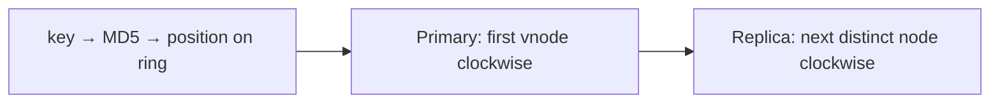
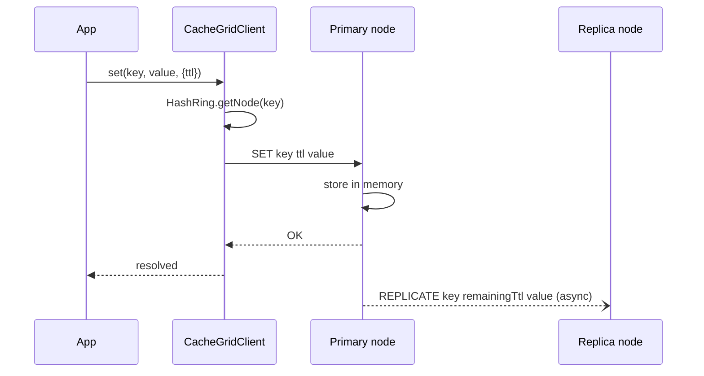
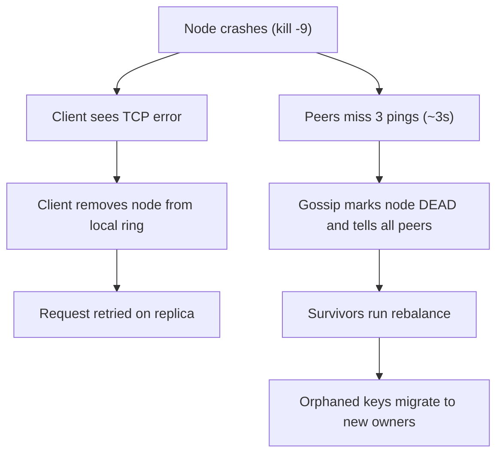

<div align="center">

# 🧊 CacheGrid

**A distributed in-memory cache cluster built from scratch in Node.js.**
No Redis. No Memcached. No external coordination libraries.


[Quick Start](#-quick-start) · [Architecture](#-architecture) · [Wire Protocol](#-wire-protocol) · [Client SDK](#-client-sdk) · [Design Decisions](#-key-design-decisions) · [Limitations](#-limitations)

</div>

---

## 📖 Overview

Multiple Node.js TCP servers form **one logical cache**. Consistent hashing distributes keys, asynchronous replication survives node failure, gossip detects dead nodes in seconds, and a client SDK hides all of it behind a dead-simple `get` / `set` / `del` interface.

Most cache tutorials show you how to *call* Redis. CacheGrid shows you what's *underneath*: every subsystem is hand-rolled and small enough to read in an afternoon.

## ✨ Features

| Subsystem | What it does |
|---|---|
| **Consistent hashing** | 150 virtual nodes per physical node, MD5-based ring, O(log N) lookup via binary search |
| **Wire protocol** | Plain-text TCP, one command per line, debuggable with `nc` |
| **Replication** | Primary writes are asynchronously replicated to the next clockwise node |
| **Gossip failure detection** | Heartbeat every 1s; 3 missed pings mark a peer `DEAD`, propagated to all peers |
| **Client failover** | Dead node detected → ring rebuilt → request retried on the replica, transparent to the caller |
| **Rebalancing** | Node joins/leaves → only the affected key range migrates (~1/N of keys) |
| **TTL on replicas** | *Remaining* TTL is propagated, so replicas expire at the same wall-clock time |
| **Chaos test** | Live traffic + `kill -9` on a node mid-flight → asserts zero errors after detection |

---

## 🚀 Quick Start

### Option A: Docker Compose (3 real nodes)

```bash
docker compose up -d

node -e "
const C = require('./src/client');
const c = new C({ seeds: ['localhost:7001','localhost:7002','localhost:7003'] });
c.set('hello', 'world', { ttl: 60000 })
  .then(() => c.get('hello'))
  .then(console.log)
  .then(() => c.close());
"
```

### Option B: Local processes

```bash
NODE_ID=node1 PORT=7001 PEERS=node2:localhost:7002,node3:localhost:7003 node src/node/index.js &
NODE_ID=node2 PORT=7002 PEERS=node1:localhost:7001,node3:localhost:7003 node src/node/index.js &
NODE_ID=node3 PORT=7003 PEERS=node1:localhost:7001,node2:localhost:7002 node src/node/index.js &
```

### Talk to a node directly (no SDK needed)

```bash
$ nc localhost 7001
SET greeting 60000 hello
OK
GET greeting
VALUE hello
PING
PONG
```

### Run the chaos test

```bash
node scripts/chaos_test.js
# 1600+ ops, kills a node mid-flight, asserts 0 errors post-detection
```

### Node configuration

| Variable | Example | Description |
|---|---|---|
| `NODE_ID` | `node1` | Unique name of this node on the ring |
| `PORT` | `7001` | TCP port this node listens on |
| `PEERS` | `node2:localhost:7002,node3:localhost:7003` | Comma-separated `id:host:port` list of the other nodes |

For full setup and deployment instructions, see **[SETUP.md](SETUP.md)** and **[DEPLOYMENT.md](DEPLOYMENT.md)**.

---

## 🏗 Architecture

```
                    ┌─────────────────────────────┐
                    │        Application           │
                    │   c.set('key', 'val', {ttl}) │
                    └──────────────┬──────────────┘
                                   │
                    ┌──────────────▼──────────────┐
                    │       CacheGridClient        │
                    │  HashRing.getNode(key)       │
                    │  persistent TCP pool         │
                    │  failover → replica retry    │
                    └──┬─────────────┬────────────┘
                       │             │
              ┌────────▼──┐     ┌────▼──────┐     ┌───────────┐
              │  node1    │     │  node2    │     │  node3    │
              │  :7001    │◄────►  :7002    │◄────►  :7003    │
              │           │  gossip + repl  │           │
              │  Store    │     │  Store    │     │  Store    │
              │  HashRing │     │  HashRing │     │  HashRing │
              └───────────┘     └───────────┘     └───────────┘
```

### The hash ring

Each physical node is placed on the ring 150 times (virtual nodes). A key is owned by the first virtual node clockwise from its hash; its replica is the next *distinct physical* node clockwise.



### SET request flow



1. Client hashes the key, picks the node via the ring, and sends `SET key ttl value\n` over a persistent TCP connection.
2. The node stores the value in memory and replies `OK\n`.
3. The node asynchronously sends `REPLICATE key remainingTtl value\n` to the next clockwise node.
4. The client returns immediately; the replica write happens in the background.

### Failure flow (node dies)



---

## 📡 Wire Protocol

Plain text over TCP, one command per line. Debuggable with `nc localhost 7001`.

| Command | Reply | Purpose |
|---|---|---|
| `SET <key> <ttl_ms> <value>` | `OK` | Store a value with a TTL |
| `GET <key>` | `VALUE <value>` or `NULL` | Read a value |
| `DEL <key>` | `OK` | Delete a key |
| `PING` | `PONG` | Liveness check / gossip heartbeat |
| `REPLICATE <key> <ttl_ms> <value>` | *(none, fire and forget)* | Primary → replica copy (internal) |
| `MIGRATE <key> <ttl_ms> <value>` | `OK` | Move a key to its new owner during rebalance (internal) |
| `PEERS <nodeId ...>` | *(none)* | Peer list update (internal) |
| `RING_UPDATE <nodeId ...>` | *(none)* | Ring change notification (internal) |

> **Note:** keys and values must not contain newlines, since the newline is the message delimiter.

---

## 🧰 Client SDK

```js
const CacheGridClient = require('./src/client');

const client = new CacheGridClient({
  seeds: ['localhost:7001', 'localhost:7002', 'localhost:7003'],
});

// SET with TTL (milliseconds)
await client.set('session:abc', JSON.stringify(user), { ttl: 1_800_000 });

// GET: returns a string, or null on miss/expiry
const val = await client.get('session:abc');

// DEL
await client.del('session:abc');

// Cleanup
client.close();
```

The client handles the distributed parts for you:

- Routes each key to the correct node via consistent hashing
- Detects connection failures and retries on the replica node
- Reconnects to recovered nodes every 3 seconds
- Queues requests until the TCP connection is established

---

## 🗂 Project Structure

```
src/
  node/
    index.js        TCP server entry: bootstraps all subsystems
    store.js        In-memory Map with lazy + sweep TTL expiry
    protocol.js     Line-buffered wire protocol parser
    replicator.js   Async replication to the replica node on the ring
    gossip.js       Heartbeat loop, missed-ping counter, DEAD/ALIVE events
    rebalance.js    Key migration when the ring changes (join / leave)
  ring/
    hashRing.js     Consistent hash ring: virtual nodes, MD5, binary search
  client/
    index.js        CacheGridClient: ring routing, connection pool, failover
scripts/
  chaos_test.js     Traffic + kill + assert zero errors
```

---

## 🧠 Key Design Decisions

<details>
<summary><b>Why consistent hashing over <code>hash(key) % N</code>?</b></summary>

Modulo hashing remaps almost every key when N changes. Consistent hashing remaps only ~1/N of them. With 3 nodes and 150 vnodes each, adding a 4th node moves ~25% of keys instead of ~75%. Virtual nodes smooth out the distribution so no single node gets an unlucky slice of the ring.
</details>

<details>
<summary><b>Why plain-text TCP over HTTP or gRPC?</b></summary>

Zero framing overhead, zero dependencies, and you can debug with `nc` or `telnet`. The trade-off: values cannot contain newlines, which is acceptable for a prototype.
</details>

<details>
<summary><b>Why asynchronous replication?</b></summary>

The primary returns `OK` before the replica acknowledges, which roughly halves write latency. The trade-off is that a write can be lost if the primary crashes between `OK` and the replica receiving `REPLICATE`. That's acceptable for a cache, where the source of truth lives elsewhere.
</details>

<details>
<summary><b>Why gossip instead of a central coordinator?</b></summary>

No single point of failure. Each node monitors every peer directly, which costs O(N²) messages, fine for N = 3–10. Full gossip protocols fan out to K random peers to cap this at O(N log N).
</details>

<details>
<summary><b>Why replicate the <i>remaining</i> TTL?</b></summary>

If the full TTL were re-sent, the replica would expire later than the primary and could serve a value the primary already considers gone. Sending the remaining TTL keeps both copies expiring at the same wall-clock time.
</details>

<details>
<summary><b>Why Node.js?</b></summary>

The single-threaded event loop means store operations need no locks or mutexes, so the core data structure stays a plain `Map`.
</details>

---

## ⚖️ CAP Theorem Position

CacheGrid is **AP**: Available and Partition-tolerant.

During a network partition, both sides keep serving reads and writes (available) but may diverge (not consistent). When the partition heals, gossip restores the ring view. Conflict policy is last-write-wins, with no vector clocks and no conflict resolution.

That's the right trade-off for a cache: a slightly stale hit is almost always better than a miss that falls through to a slow database.

### Guarantees at a glance

| Scenario | Behavior |
|---|---|
| Single node crash | Reads/writes continue via the replica after detection (~3s) |
| Write acknowledged, primary dies before replication | Write may be lost (async replication) |
| Network partition | Both sides stay available; data may diverge; last write wins |
| Node restart | Local data is lost (in-memory only, no persistence) |
| Key expiry | Lazy expiry on access plus a background sweep; replicas expire at the same wall-clock time |

---

## 🔥 Chaos Test Results

```
=== CacheGrid Chaos Test ===

[1] Warming up (2s)...           ops: 1653
[2] Running pre-kill traffic...  ops: 1657
[3] Killing node2...
[4] Waiting for gossip (5s)...   errors during detection window: 0
[5] Verifying post-detect (5s).. errors post-settle: 0

=== Results ===
Total ops:              1657
Errors (gossip window):  0
Errors (post-settle):    0

✓ PASS — chaos test passed
```

> The test asserts that requests *succeed* during and after a node failure. It does not yet verify that returned values are correct. See [Limitations](#-limitations).

---

## 🛠 Tech Stack

| Layer | Choice | Why |
|---|---|---|
| Runtime | Node.js 20 | Single-threaded event loop, no mutex needed for store ops |
| Transport | `net` module (raw TCP) | Zero overhead, fully async, no HTTP framing |
| Hashing | `crypto` MD5 (built-in) | Fast, uniform distribution, no dependencies |
| Containers | Docker + Docker Compose | Realistic multi-node simulation locally |
| External libs | None (intentional) | Every subsystem is visible and explainable |

---

## 🚧 Limitations

CacheGrid is a learning project and prototype. It is **not** production-ready. Known gaps:

- **Durability:** no persistence; a node restart loses its local data.
- **Replication reliability:** replica writes are not acknowledged or retried, and deletions are not replicated.
- **Failure recovery:** dead-node probing and ring convergence on recovery need hardening.
- **Conflict handling:** concurrent writes during partitions are last-write-wins with no versioning.
- **Protocol safety:** no input validation or robust framing; keys and values can't contain newlines.
- **Security:** no authentication or encryption; do not expose to untrusted networks.
- **Testing and observability:** chaos test doesn't check value correctness; no metrics, structured logs, or health endpoints.
- **Scale:** all-to-all peer monitoring targets small clusters (3–10 nodes).

## 🗺 Roadmap

- [ ] Replicate `DEL` and acknowledge/retry replica writes
- [ ] Optional disk snapshots for restart recovery
- [ ] Value-correctness assertions in the chaos test
- [ ] Versioned writes (vector clocks or explicit conflict policy)
- [ ] Length-prefixed framing to support arbitrary keys and values
- [ ] Randomized gossip fan-out (K peers) for larger clusters
- [ ] Metrics, structured logging, and a health endpoint
- [ ] Benchmarks across cluster sizes and workloads
- [ ] Auth and TLS

---

## 🤝 Contributing

Issues and pull requests are welcome. If you're changing a subsystem, please run `node scripts/chaos_test.js` before opening a PR.

## 📚 Further Reading

- Karger et al., *Consistent Hashing and Random Trees* (1997)
- DeCandia et al., *Dynamo: Amazon's Highly Available Key-value Store* (2007)
- Das et al., *SWIM: Scalable Weakly-consistent Infection-style Process Group Membership Protocol* (2002)

## 📄 License

Add your license here (e.g. MIT) and include a `LICENSE` file in the repo root.
